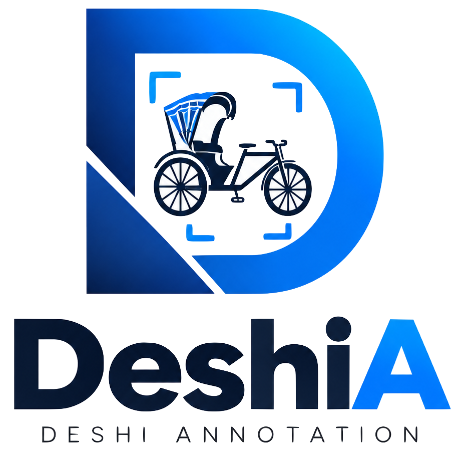

<div align="center">



# DeshiA

**Deshi Annotation**

An open-source, offline **desktop image-annotation workstation** for building structured computer-vision datasets — hierarchical labeling, bounding boxes, face-privacy mosaic, crash-safe progress, and reproducible multi-format export.

[](LICENSE)
[](CHANGELOG.md)
[](https://www.typescriptlang.org)
[](https://nextjs.org)
[](https://tauri.app)
[](https://orm.drizzle.team)
[](https://github.com/0mehedihasan/deshia)

</div>

---

## Overview

**DeshiA (Deshi Annotation)** is a desktop workstation for turning a folder of raw images into a **clean, structured, reproducible computer-vision dataset**. A Next.js UI drives a local Node backend (SQLite + Sharp) inside a [Tauri v2](https://tauri.app) shell, so everything runs **offline on your machine** — no cloud, no uploads, and source images never leave the disk.

**The problem it solves.** Most annotation tools either live in the cloud, flatten everything to one label per box, or leave you to invent your own folder conventions. Research datasets need more: a controlled ontology, a consistent file layout, and outputs a trainer can consume without hand-fixing. DeshiA enforces that structure end to end and guarantees the on-disk result is reproducible from the recorded state.

**Who it's for.** Computer-vision researchers, dataset builders, and ML engineers who need labeled detection data with a defensible, repeatable structure — and who want to keep their images local.

**Why structured annotation matters.** A detection dataset is only as trustworthy as its labels are consistent. By modeling the label space as a schema (Dataset → Class → View → Component) rather than a flat tag list, DeshiA keeps every annotator inside the same controlled vocabulary, records the exact schema version each annotation was made against, and writes a deterministic file tree — so the dataset can be regenerated, audited, and extended long after it was first labeled.

> **Status** — `v0.1.0`, active development. First target dataset: a Bangladeshi **Rickshaw / E-Rickshaw** set (~500 images). The Rickshaw ontology is the _first_ dataset, **not** a built-in limitation — the annotation engine is schema-driven.

### Full CVAT-style toolset (included)

Alongside the original Rickshaw component workflow, DeshiA now includes an
**Objects** editor for any dataset:

- 8 shape types — rectangle (2-point or 4-point), rotated box, ellipse, polygon,
  polyline, point, points group and 2D cuboid — with attributes, occlusion,
  z-order, visibility, lock and deterministic colors.
- CVAT-style editing: vertex insert/delete, snapping, freehand, crosshair, live
  dimensions, marquee multi-select, clipboard, zoom/pan/fit, four stacking
  operations and undo/redo.
- A local **schema editor** with immutable published versions and JSON
  import/export — annotations always reference stable label ids.
- **Video** annotation: frame navigation, keyframe markers, read-time
  interpolation and tracks (needs `ffmpeg` on the device for frame previews).
- **Exports**: Pascal VOC, COCO (including a dataset-level aggregate), YOLO,
  CVAT 1.1 XML + ZIP and a lossless native project, plus importers for all of
  them. Lossy conversions are always reported.
- **Reliability**: autosave, revision restore, explicit crash-draft recovery,
  conflict resolution, local analytics and snapshot backups.
- **Optional multi-user mode** (sign-in, roles, admin user screen) — **off by
  default**; set `DESHIA_MULTIUSER=1` to enable it.

See the [feature parity notes](docs/rooyacvat-parity.md) for the worked port,
[optional multi-user mode](docs/optional-auth.md) for the flag, and the
[complete build guide](docs/BUILD-ANNOTATION-TOOL.md) if you want to build your
own annotation tool with these patterns.

## Contents

- [Key features](#key-features) · [Annotation model](#annotation-model) · [Rickshaw / E-Rickshaw schema](#built-in-rickshaw--e-rickshaw-schema)
- [Bounding boxes & colors](#bounding-boxes--colors) · [Dataset structure & export](#dataset-structure--export)
- [Architecture](#architecture) · [Tech stack](#tech-stack) · [Getting started](#getting-started) · [Scripts](#scripts) · [Project structure](#project-structure)
- [Desktop builds](#building-the-desktop-app) · [Testing](#testing) · [Docs](#documentation) · [Roadmap](#roadmap) · [Contributing](#contributing) · [License](#license)
- [Build an annotation tool](docs/BUILD-ANNOTATION-TOOL.md) · [Reusable agent skill](.claude/skills/annotation-tool-builder/SKILL.md) · [Code of conduct](CODE_OF_CONDUCT.md)

## Key features

Everything listed here is implemented today. Planned work lives in the [Roadmap](#roadmap).

| Area                          | What it does                                                                                                                                                                                                                                                      |
| ----------------------------- | ----------------------------------------------------------------------------------------------------------------------------------------------------------------------------------------------------------------------------------------------------------------- |
| **Workspaces**                | Point DeshiA at a read-only source folder and an output folder; it validates the paths and scaffolds the full `DeshiA_Output/` tree up front. Rename or delete workspaces — delete is DB-only, so your images and existing output are left untouched on disk.     |
| **Source scanning**           | Recursive discovery with **SHA-256** checksums, Sharp-read dimensions/metadata, and duplicate / unsupported-format classification. Duplicates are detected by content hash, never by filename.                                                                    |
| **Hierarchical labeling**     | Dataset → Class → View → Component, entirely resolved from the active schema. Changing the class changes the available views; changing the view changes the available components.                                                                                 |
| **Bounding boxes**            | A Konva canvas with draw / move / resize, normalized `0..1` storage, and live validation (`0 ≤ xMin < xMax ≤ 1`).                                                                                                                                                 |
| **Distinct semantic colors**  | A deterministic, perceptually separated, color-blind-aware palette assigned by component key — no two different components in one image ever share a color.                                                                                                       |
| **Visibility states**         | Each component can be marked `VISIBLE`, `OCCLUDED`, or `NOT_VISIBLE`; the schema decides when a box is required.                                                                                                                                                  |
| **Privacy face mosaic**       | Hide human faces with a resizable circular tool. Each region is pixelated with a hard, **irreversible mosaic** baked into every exported copy (RAW, ANNOTATED, and visualizations) — source images are never modified, and redactions survive class/view changes. |
| **Autosave & crash recovery** | Drafts persist continuously inside transactions; an append-only `annotation_events` log makes any interrupted session resumable to exact state.                                                                                                                   |
| **Multi-format export**       | Submissions write Pascal VOC XML, COCO JSON (plus a dataset-level aggregate), YOLO TXT, CVAT 1.1 XML + ZIP and a native lossless project — plus clean RAW / ANNOTATED copies and a box-rendered preview, through a verified transaction. |                                                                   |
| **Progress & inventory**      | A per-workspace dashboard with pending / in-progress / annotated / skipped counts, plus a read-only scan of what actually exists on disk, broken down by class and view.                                                                                          |
| **Navigation**                | Dataset-order Previous / Next paging and one-click resume of the next pending image.                                                                                                                                                                              |
| **Desktop app**               | Native folder pickers and a packaged installer (Tauri v2) that runs without a dev server. Fully offline.                                                                                                                                                          |

## Annotation model

Everything the annotator sees is generated from a schema — nothing about Rickshaws is compiled into the engine:

```
Dataset → Class → View / Subclass → Component → Visibility rule → Bounding-box rule
```

- **Class** — top-level category; selecting one determines the available views.
- **View / subclass** — perspective or variant; selecting one determines the available components.
- **Component** — a labeled part that may need one or more bounding boxes.
- **Visibility** — `VISIBLE`, `OCCLUDED`, or `NOT_VISIBLE`. Combined with the component's box rule (`required` / `optional` / `none`), it decides whether a box is required before submit.

Annotate only **major** structural / mechanical / electrical / class-discriminative components — not decorative parts, screws, tiny lights, or individual spokes, unless a future schema explicitly configures them. See [`docs/annotation-schema.md`](docs/annotation-schema.md) for the full visibility × box-rule matrix.

### Built-in Rickshaw / E-Rickshaw schema

The first dataset ships in [`src/schemas/rickshaw.ts`](src/schemas/rickshaw.ts). Classes: **Rickshaw**, **E-Rickshaw**. Views: **Front**, **Side**, **Back**. Every component below is **required** except where noted.

| Class      | View  | Required components                                        | Optional | Domain rule                                                              |
| ---------- | ----- | ---------------------------------------------------------- | -------- | ------------------------------------------------------------------------ |
| Rickshaw   | Front | Rickshaw Body, Steering Head                               | —        |                                                                          |
| Rickshaw   | Side  | Rickshaw Body, Pedal / Crank Assembly, Chain               | —        | **Chain is a separate box** — never merge it into Pedal / Crank Assembly |
| Rickshaw   | Back  | Rickshaw Body, Rear Drive Assembly                         | —        | The round rear part is **Rear Drive Assembly**, _not_ a "Motor"          |
| E-Rickshaw | Front | E-Rickshaw Body, Steering Head, Electric Control / Circuit | —        |                                                                          |
| E-Rickshaw | Side  | E-Rickshaw Body, Electric Drive Area                       | Pedal    | The pedal is **optional** — not required when absent                     |
| E-Rickshaw | Back  | E-Rickshaw Body, Electric Motor                            | —        |                                                                          |

> Want a different dataset? Author a new `AnnotationSchema` (validated with Zod) — the engine and UI adapt with **zero** code changes. Each annotation records the `schemaId` and `schemaVersion` it was made against, so exports stay reproducible as the schema evolves.

## Bounding boxes & colors

- **Normalized coordinates.** Boxes are stored normalized to `0..1` and validated (`0 ≤ xMin < xMax ≤ 1`, `0 ≤ yMin < yMax ≤ 1`); pixel conversion happens only at the canvas and exporter edges, so annotations are resolution-independent.
- **Semantic identity.** Every box carries its component key, so a box _means_ a specific part in the ontology rather than being an anonymous rectangle.
- **Deterministic colors.** Colors are assigned **by component key** (from the component's position in the class+view list), not by render order — so they are stable within a session and adding a box never recolors an existing component. Different components in one image never collide; components beyond the base palette get the next perceptually distinct hue by golden-angle rotation.
- **Legibility & accessibility.** The base palette is an adapted, color-blind-aware Okabe–Ito set; meaning is never encoded by red/green alone. Border and label text share the component color, the label background is a darker translucent variant, and the interior fill stays ~10% opacity so the underlying image is never obscured. See [`src/core/annotation/palette.ts`](src/core/annotation/palette.ts).

## Dataset structure & export

DeshiA writes a single `DeshiA_Output/` tree under your chosen output folder, keeping **clean dataset data and human-facing visualizations strictly separate**:

```
DeshiA_Output/
├─ RAW/                                original images, copied (never modified)
│  ├─ rickshaw/{front,side,back}/
│  └─ e_rickshaw/{front,side,back}/
├─ ANNOTATED/
│  ├─ classes.txt                      dataset-level YOLO class list (shared)
│  ├─ rickshaw/{front,side,back}/
│  │  ├─ images/                        clean images — NO boxes drawn
│  │  └─ annotations/                   one .xml (VOC) + .json (COCO) + .txt (YOLO) per image
│  └─ e_rickshaw/{front,side,back}/{images,annotations}/
└─ VISUALIZATIONS/                      box-rendered previews only (viz_*)
   ├─ rickshaw/{front,side,back}/
   └─ e_rickshaw/{front,side,back}/
```

- The **`ANNOTATED` dataset holds clean images** (no overlays). Boxes are drawn **only** into `VISUALIZATIONS/`, so the dataset itself is never contaminated.
- Filenames derive from the persistent `datasetIndex` (never a directory file count): `raw_<class>_<view>_<NNN>.jpg`, `annotated_<class>_<view>_<NNN>.(jpg|xml|json|txt)`, and `viz_<class>_<view>_<NNN>.jpg`. All names are sanitized to lower snake case; source filenames are never trusted as identifiers.

### Export formats

Every submitted image produces **all three** annotation formats at once — there is no toggle, so a workspace is ready for any trainer without re-exporting. All three describe the same objects (every box whose component is not `NOT_VISIBLE`) and use the **schema component key** as the class name, so labels are identical across formats.

| Format         | File              | Notes                                                                                                              |
| -------------- | ----------------- | ------------------------------------------------------------------------------------------------------------------ |
| **Pascal VOC** | `.xml` per image  | Integer-pixel `bndbox`, `difficult=1` for occluded boxes, deterministic/byte-stable output.                        |
| **COCO**       | `.json` per image | Self-contained per-image document (`bbox` = `[x, y, w, h]` in pixels, 1-based `category_id`), trivially mergeable. |
| **YOLO**       | `.txt` per image  | Normalized `cx cy w h`, 0-based class id; an image with no objects yields a valid empty (background) label.        |

A single dataset-level `ANNOTATED/classes.txt` lists the class ids, derived from a deterministic whole-schema label map so ids stay consistent across every folder. See [`docs/export-format.md`](docs/export-format.md).

### Example: one image, three label files

One submitted image produces all three formats at once. Below is a real image from the sample Rickshaw set — a **Back** view labeled with two components, `rickshaw_body` and `rear_drive_assembly` (the round rear part, which DeshiA deliberately does _not_ call a "motor"):

```
Class       Rickshaw
View        Back
Image       2296 × 4080 px  ·  datasetIndex 024
Components  rickshaw_body        · VISIBLE
            rear_drive_assembly  · VISIBLE
```

On submit it lands on disk like this — the dataset image stays clean, boxes are drawn into `VISUALIZATIONS/` only:

```
ANNOTATED/
├─ classes.txt                                    shared, dataset-level
└─ rickshaw/back/
   ├─ images/annotated_rickshaw_back_024.jpg      clean copy — no boxes drawn
   └─ annotations/
      ├─ annotated_rickshaw_back_024.txt          YOLO
      ├─ annotated_rickshaw_back_024.xml          Pascal VOC
      └─ annotated_rickshaw_back_024.json         COCO
```

**YOLO** — one line per box, `<class_id> <x_center> <y_center> <width> <height>`, all normalized `0..1`:

```
4 0.487246 0.588517 0.535652 0.073365
0 0.490081 0.410686 0.693808 0.645952
```

Each leading id indexes the shared `ANNOTATED/classes.txt` — line `N` (0-based) is class id `N`, so `4` → `rear_drive_assembly` and `0` → `rickshaw_body`:

```
rickshaw_body
steering_head
pedal_crank_assembly
chain
rear_drive_assembly
e_rickshaw_body
electric_control_circuit
electric_drive_area
pedal
electric_motor
```

**Pascal VOC** — `annotated_rickshaw_back_024.xml`, each box as integer pixels (`difficult=1` marks an occluded box):

```xml
<annotation>
  <folder>images</folder>
  <filename>annotated_rickshaw_back_024.jpg</filename>
  <path>…/ANNOTATED/rickshaw/back/images/annotated_rickshaw_back_024.jpg</path>
  <source>
    <database>DeshiA</database>
  </source>
  <size>
    <width>2296</width>
    <height>4080</height>
    <depth>3</depth>
  </size>
  <segmented>0</segmented>
  <object>
    <name>rear_drive_assembly</name>
    <pose>Unspecified</pose>
    <truncated>0</truncated>
    <difficult>0</difficult>
    <bndbox>
      <xmin>505</xmin>
      <ymin>2252</ymin>
      <xmax>1734</xmax>
      <ymax>2551</ymax>
    </bndbox>
  </object>
  <object>
    <name>rickshaw_body</name>
    <pose>Unspecified</pose>
    <truncated>0</truncated>
    <difficult>0</difficult>
    <bndbox>
      <xmin>330</xmin>
      <ymin>359</ymin>
      <xmax>1922</xmax>
      <ymax>2993</ymax>
    </bndbox>
  </object>
</annotation>
```

**COCO** — `annotated_rickshaw_back_024.json`, a self-contained per-image document; `bbox` is `[x, y, width, height]` in pixels and `category_id` is 1-based (the `categories` array carries all ten classes from `classes.txt` — only the first is shown here for brevity):

```json
{
  "info": { "description": "DeshiA annotation export", "version": "1.0", "generator": "DeshiA" },
  "images": [
    { "id": 24, "file_name": "annotated_rickshaw_back_024.jpg", "width": 2296, "height": 4080 }
  ],
  "annotations": [
    {
      "id": 1,
      "image_id": 24,
      "category_id": 5,
      "bbox": [503.79, 2251.48, 1229.86, 299.33],
      "area": 368133.11,
      "iscrowd": 0,
      "segmentation": []
    },
    {
      "id": 2,
      "image_id": 24,
      "category_id": 1,
      "bbox": [328.73, 357.86, 1592.98, 2635.49],
      "area": 4198283.2,
      "iscrowd": 0,
      "segmentation": []
    }
  ],
  "categories": [{ "id": 1, "name": "rickshaw_body", "supercategory": "component" }]
}
```

All three files describe the **same two boxes** — VOC in integer pixels, COCO in pixel `[x, y, w, h]`, YOLO in normalized center form — so the workspace is ready for any trainer with no re-export.

### Face redaction (privacy)

To publish datasets that contain people, DeshiA can **mosaic (pixelate) human faces** with a resizable circular tool.

- **Irreversible by design.** Each circular region is averaged down to a handful of blocks (≤ 8 across its longer edge) and expanded back with hard, nearest-neighbour squares — a mosaic that destroys facial detail for good, not a soft blur that can leave a face recognizable.
- **Baked into every copy.** The mosaic is applied to the RAW, ANNOTATED, and VISUALIZATIONS copies alike, because a face left un-masked in any one of them defeats the purpose. The **source image is never touched**.
- **Resolution-independent & ontology-free.** Redactions are stored as normalized circles (`{ cx, cy, r }`), so they stay round at any resolution and **survive class/view changes** (unlike boxes, which reset). They are an export-time privacy layer, never part of the label set.

### Submission transaction

Export runs inside one atomic flow (`src/core/exporter/submit.ts`), and **an image is marked `ANNOTATED` only after its files are verified on disk**:

1. Validate annotation → 2. Persist to DB → 3. Generate VOC + COCO + YOLO + `classes.txt` → 4. Copy RAW image (any faces mosaicked in) → 5. Copy clean ANNOTATED image (faces mosaicked in), write annotation files, render the `VISUALIZATIONS` preview (best-effort) → 6. **Verify every dataset file exists and is non-empty** → 7. Update DB → 8. Mark `ANNOTATED` → 9. Load next `PENDING`.

Any failure preserves the draft, surfaces an actionable error, and allows retry — nothing is ever silently lost, and no image is marked complete on a partial write.

## Architecture

Strictly layered — dependencies point one direction, and **no database or filesystem logic ever lives in a React component**.

```
UI  (Next.js App Router + React components)
      ↓
Application services  (server actions / route handlers — orchestration)
      ↓
Domain logic  (src/core: annotation engine, validation, exporter, recovery, scanner)
      ↓
Persistence  (src/db: Drizzle schema + repositories)
      ↓
Filesystem  (source images read-only · DeshiA_Output written)
```

**Runtime model.** The heavy lifting (Drizzle + `better-sqlite3`, filesystem scanning, Sharp, export) runs in the **Next.js Node runtime**. Tauri stays a thin shell: it hosts the webview, provides native folder dialogs, and — in a packaged build — launches the bundled Node server. See [`docs/architecture.md`](docs/architecture.md).

## Tech stack

| Layer      | Technology                                                                                                                                             |
| ---------- | ------------------------------------------------------------------------------------------------------------------------------------------------------ |
| Framework  | [Next.js 14](https://nextjs.org) (App Router) · [React 18](https://react.dev)                                                                          |
| Language   | [TypeScript 5.6](https://www.typescriptlang.org) — **strict**, no `any`, no enums (`as const` unions)                                                  |
| UI         | [Tailwind CSS](https://tailwindcss.com) · [shadcn/ui](https://ui.shadcn.com) (Radix) · [Lucide](https://lucide.dev) · [Geist](https://vercel.com/font) |
| State      | [Zustand](https://zustand-demo.pmnd.rs)                                                                                                                |
| Canvas     | [Konva](https://konvajs.org) / [react-konva](https://konvajs.org/docs/react)                                                                           |
| Database   | [SQLite](https://www.sqlite.org) via [Drizzle ORM](https://orm.drizzle.team) + [better-sqlite3](https://github.com/WiseLibs/better-sqlite3)            |
| Images     | [Sharp](https://sharp.pixelplumbing.com) (metadata + copies)                                                                                           |
| Validation | [Zod](https://zod.dev)                                                                                                                                 |
| Desktop    | [Tauri v2](https://tauri.app) (Rust shell + bundled Node server)                                                                                       |
| Testing    | [Vitest](https://vitest.dev) (unit) · [Playwright](https://playwright.dev) (e2e)                                                                       |
| Tooling    | [pnpm](https://pnpm.io) · ESLint · Prettier                                                                                                            |

## Getting started

### Prerequisites

- **Node.js** ≥ 20.11 and **pnpm** 9 (`corepack enable`)
- **Rust** stable + the [Tauri v2 prerequisites](https://tauri.app/start/prerequisites/) — only needed to run or build the desktop shell

```bash
git clone https://github.com/0mehedihasan/deshia.git
cd deshia
pnpm install
pnpm db:generate      # generate SQLite migrations from the Drizzle schema
```

### Run in the browser (fastest inner loop)

```bash
pnpm dev              # http://localhost:3000
```

> In plain browser mode the native folder picker is inert by design — type absolute paths directly, or run the desktop shell below for real dialogs.

### Run as the desktop app

```bash
pnpm tauri:dev        # native window + folder dialogs, hot-reloads the UI
```

## Scripts

| Command                           | Description                                       |
| --------------------------------- | ------------------------------------------------- |
| `pnpm dev`                        | Next.js dev server (browser)                      |
| `pnpm tauri:dev`                  | Desktop shell in dev mode (native dialogs)        |
| `pnpm build`                      | Production Next.js build (`output: 'standalone'`) |
| `pnpm tauri:build`                | Package the desktop app (`.dmg` / installer)      |
| `pnpm typecheck`                  | `tsc --noEmit` — strict type check                |
| `pnpm lint`                       | ESLint (`next lint`)                              |
| `pnpm format` / `format:check`    | Prettier write / check                            |
| `pnpm test` / `test:watch`        | Vitest unit tests                                 |
| `pnpm test:e2e`                   | Playwright end-to-end tests                       |
| `pnpm db:generate` / `db:migrate` | Generate / apply Drizzle migrations               |

## Project structure

```
deshia/
├─ src/
│  ├─ app/            Next.js routes, layouts, server actions, route handlers
│  ├─ components/     Reusable UI (incl. components/ui shadcn primitives)
│  ├─ features/       Screen modules: welcome · dashboard · annotation · settings
│  ├─ core/           Framework-free domain logic
│  │  ├─ scanner/       recursive scan, checksum, Sharp metadata, classification
│  │  ├─ filesystem/    path validation, filename sanitization, output tree
│  │  ├─ annotation/    schema-driven engine, color palette, bbox math, validation
│  │  ├─ recovery/      draft detection + resume
│  │  ├─ exporter/      VOC / COCO / YOLO, label map, visualizations, submission
│  │  └─ validation/    shared validators
│  ├─ db/             Drizzle schema, repositories, migrations (server-only)
│  ├─ schemas/        AnnotationSchema types, Zod validation, built-in Rickshaw schema
│  ├─ stores/         Zustand client stores (working state, autosave status)
│  └─ lib/ hooks/ types/ utils/
├─ src-tauri/         Rust desktop shell (webview, dialogs, Node-sidecar packaging)
├─ docs/              Architecture & subsystem documentation
├─ e2e/               Playwright specs
└─ scripts/           build-desktop.mjs (packaging pipeline)
```

## Building the desktop app

`pnpm tauri:build` runs the full packaging pipeline (`scripts/build-desktop.mjs`):

1. `next build` produces a standalone Node server.
2. The server plus Drizzle migrations are staged into a single `app.tar` resource, and a Node runtime is bundled as an `externalBin`.
3. At launch the Rust shell extracts `app.tar` to a writable per-user dir, spawns `node server.js` on a free loopback port, and points the webview at it — so the packaged app needs **no local dev server**.

<details>
<summary>Notes for macOS builds</summary>

- Native addons (`better-sqlite3`, `sharp`) and the bundled Node binary can't be cross-compiled — build on the target OS.
- The `.dmg` is **unsigned**: on first open, right-click the app → **Open** to get past Gatekeeper.
- Startup progress and any failure are written to `deshia-launch.log` in the app-data directory.

</details>

## Testing

```bash
pnpm typecheck        # strict TypeScript
pnpm lint             # ESLint
pnpm test             # Vitest unit tests
pnpm test:e2e         # Playwright: workspace → scan → annotate → save → resume → submit → verify
```

Unit tests cover the pure logic: scanning, checksums, schema & annotation validation, bbox normalization, color assignment, filename generation, and VOC / COCO / YOLO / visualization output. The Playwright spec drives the full annotation loop end to end.

## Documentation

| Doc                                                       | Topic                                                                       |
| --------------------------------------------------------- | --------------------------------------------------------------------------- |
| [architecture.md](docs/architecture.md)                   | Layers, runtime model, dev vs. packaged                                     |
| [annotation-schema.md](docs/annotation-schema.md)         | Authoring a schema for a new dataset                                        |
| [dataset-format.md](docs/dataset-format.md)               | Input expectations & classification                                         |
| [export-format.md](docs/export-format.md)                 | VOC / COCO / YOLO output, label map, visualizations, submission transaction |
| [recovery.md](docs/recovery.md)                           | Draft detection and crash recovery                                          |
| [development.md](docs/development.md)                     | Local setup & workflow                                                      |
| [claude-context.md](docs/claude-context.md)               | Context for AI coding agents                                                |
| [BUILD-ANNOTATION-TOOL.md](docs/BUILD-ANNOTATION-TOOL.md) | Full guide to building an annotation tool from scratch                      |
| [rooyacvat-parity.md](docs/rooyacvat-parity.md)           | Worked CVAT-style feature port and honest status                            |
| [optional-auth.md](docs/optional-auth.md)                 | Opt-in multi-user mode                                                      |
| [geometry-and-schema.md](docs/geometry-and-schema.md)     | Recursive schema and geometry engine                                        |

## Roadmap

Implemented:

- [x] Schema-driven annotation engine + built-in Rickshaw / E-Rickshaw schema
- [x] Autosave, append-only event log, and crash recovery
- [x] Multi-format export — Pascal VOC, COCO, YOLO, CVAT XML + ZIP, native project
- [x] Generalized Objects editor with 8 geometry kinds, attributes and CVAT tools
- [x] Local schema editor with immutable published versions
- [x] Video frames, tracks, keyframes and interpolation (ffmpeg optional)
- [x] Keyboard-first editing, revision restore and explicit crash recovery
- [x] Privacy face-mosaic and label-driven redaction baked into exported copies
- [x] Packaged desktop app (Tauri v2 + bundled Node server)
- [x] Optional multi-user mode behind `DESHIA_MULTIUSER=1`

Out of scope (single-user product decision):

- [ ] Remote identity providers, hosted teams, assignments and review approvals
- [ ] Cloud storage adapters and remote inference
- [ ] Brush/mask, skeleton, relations and tags annotation types

See [CHANGELOG.md](CHANGELOG.md) for release notes.

## Contributing

Contributions are welcome. Please read [CONTRIBUTING.md](CONTRIBUTING.md) and [AGENTS.md](AGENTS.md) (guidance for AI coding agents) before opening a PR. The essentials:

- Keep the dataset ontology in **schemas**, never in the core engine.
- Never silently lose annotation data; never mark `ANNOTATED` before files are verified on disk.
- No DB or filesystem logic inside React components.
- Run `pnpm typecheck && pnpm lint && pnpm test` before submitting.

## Security

Source images are treated as read-only, imported schemas are Zod-validated, and every filesystem path is checked against traversal before a write. Found a vulnerability? See [SECURITY.md](SECURITY.md) for responsible disclosure.

## License

Licensed under the [Apache License 2.0](LICENSE) © Md. Mehedi Hasan.

## Author

**Md. Mehedi Hasan** — Researcher / AI Engineer
Advanced Machine Intelligence Research Lab (AMIR Lab), Dept. of CSE
Bangladesh University of Business and Technology (BUBT), Dhaka
GitHub: [@0mehedihasan](https://github.com/0mehedihasan)

## Citation

If DeshiA supports your research, please cite it:

```bibtex
@software{hasan_deshia_2026,
  author  = {Hasan, Md. Mehedi},
  title   = {DeshiA: A Schema-Driven Image Annotation Workstation for Computer Vision Research},
  year    = {2026},
  url     = {https://github.com/0mehedihasan/deshia},
  version = {0.1.0}
}
```

<div align="center">
<sub>Built for reproducible computer-vision datasets · Correctness → data safety → usability → recovery.</sub>
</div>
